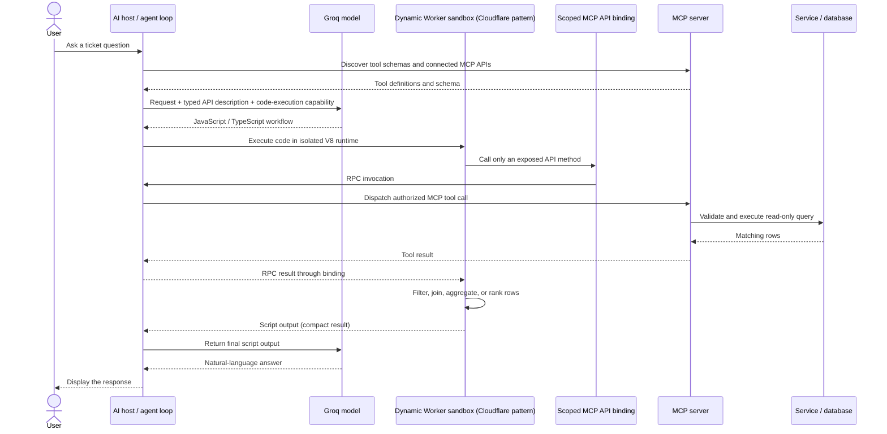

# Traditional MCP vs Code Mode: Project Guide

This guide explains the architecture, hands-on demo, setup, and how to read the comparison results in this repository.

## 1. Objective

This project demonstrates two ways an AI workflow can use the same support-ticket data through the Model Context Protocol (MCP):

1. **Traditional MCP tool calling:** the model selects MCP tools, receives their results in its conversation, and produces the answer.
2. **Code Mode:** the model writes a small program, that program runs in an isolated execution environment, calls MCP tools through a narrow bridge, processes the returned rows, and sends a compact result back to the model or UI.

The aim is to make the data flow visible and compare model-reported token usage, API requests, tool calls, query counts, rows, and result payload size. Code Mode can reduce the amount of intermediate data sent to the model for aggregation-heavy tasks, but it does not guarantee fewer tokens on every request. Code generation, retries, output wording, and query size all affect the total.

**Important scope:** this repository is a local demonstration inspired by Cloudflare Code Mode. It uses a QuickJS child process and a local MCP RPC bridge. It does not deploy Cloudflare Workers or Cloudflare's Dynamic Worker V8 isolate. See [Cloudflare's Code Mode article](https://blog.cloudflare.com/code-mode/) for Cloudflare's described architecture.

## 2. Traditional MCP: detailed architecture flow

MCP is the common tool-connectivity protocol in this demo. The AI host is responsible for connecting the model to an MCP client, and the MCP server publishes tools that wrap the ticket database.

```mermaid
sequenceDiagram
    actor User
    participant Host as AI host / agent
    participant LLM as Groq model
    participant Client as MCP client
    participant Server as Local MCP server
    participant DB as MySQL database
    User->>Host: Ask a ticket question
    Host->>Client: Connect over stdio; initialize session
    Host->>Server: Discover available tools
    Client-->>Host: get_ticket_schema, run_ticket_query schemas
    Host->>LLM: User request + tool definitions
    LLM-->>Host: Tool call (for example, get_ticket_schema)
    Host->>Server: Call MCP tool
    Server-->>Host: Schema or query result
    Host->>LLM: Tool result in conversation context
    LLM-->>Host: Next tool call or final answer
    Host->>Server: Run the model-generated SELECT
    Server->>DB: Validate and execute read-only query
    DB-->>Server: Rows
    Server-->>Host: Rows as JSON text
    Host->>LLM: Query result rows in tool message
    LLM-->>Host: Final answer based on returned rows
    Host-->>User: Display the response
```

In `live_demo.py`, the MCP server runs as a local stdio subprocess. The host discovers its tool definitions and passes those definitions to Groq. Groq chooses tools and supplies arguments. The host forwards tool calls to MCP and returns tool results to Groq. In this path, query-result rows are included in the following model request so the model can summarize them.

The MCP tools are:

- `get_ticket_schema`: returns the available tables, columns, relationships, and interpretation guidance.
- `run_ticket_query`: accepts an SQL string, validates it, runs it against MySQL in a read-only transaction, and returns JSON rows.

MCP standardizes discovery and invocation. It does not itself write the database query, determine whether the answer is correct, or eliminate the need for server-side permissions and validation.

## 3. Code Mode: detailed architecture flow

Cloudflare's article describes a pattern where the model sees a code-execution capability and a typed API for connected MCP servers. Generated TypeScript runs in an isolated V8 Worker. The sandbox can reach connected services through explicitly provided bindings; RPC calls return through the agent loop to the relevant MCP server. The script's output is then returned to the agent. The article describes isolates as lightweight and disposable, and explains that bindings can keep credentials in the supervising host rather than exposing API keys to generated code.



The important difference is where intermediate work happens. With traditional tool calling, returned rows are commonly passed back into model context. With Code Mode, code can process those rows in the sandbox and return only its output. The model still needs enough schema and API information to write the code, and the final output still returns to the model/agent.

### How this repository implements the pattern locally

The flow in this repository is similar in concept but uses local components:

1. Python connects to the local MCP server and retrieves the ticket schema.
2. Python sends the request, schema, and Code Mode instructions to Groq.
3. Groq returns JavaScript as plain text. The app asks for runnable code and makes a limited regeneration/repair attempt if generation or execution fails.
4. `local_code_sandbox.py` starts a separate QuickJS child process and passes only the generated code to it.
5. JavaScript can call `mcp.call('run_ticket_query', {sql: '...'})`. The child process sends an RPC message to the trusted Python parent.
6. The parent permits only the read-only `run_ticket_query` tool and sends the query to the MCP server.
7. Query rows return to QuickJS for filtering, grouping, ranking, or other requested transformations.
8. The sandbox returns JSON-serializable rows to the local app, which formats the result for the UI. The ticket rows are not sent back to Groq for a separate summarization request.

**Security distinction:** the child process has a reduced environment and no application credentials, filesystem API, or network API exposed to its JavaScript context. However, it runs under the same Windows user account. This demo is not a hardened OS security boundary and should not be exposed as a public execution service.

## 4. Pros and cons

| Aspect | Traditional MCP tool calling | Code Mode |
|---|---|---|
| Model-facing interface | Model selects among discovered tools. | Model writes code against a typed API, typically using one code-execution capability. |
| Data processing | The model can inspect each tool result directly. | Code can filter, transform, join, or aggregate intermediate results before returning output. |
| Context use | Tool definitions and returned data may add to model context. | Intermediate rows can stay in the sandbox; only script output needs to return to the agent/model. |
| Multi-step tasks | May require repeated model/tool round trips. | Can compose multiple tool operations and local processing in one generated workflow. |
| Security boundary | MCP server enforces authorization and validates tool input. | Sandbox can limit generated code to explicit bindings; host retains authorization and credentials. The sandbox still needs careful design. |
| Operational complexity | Straightforward to understand and debug for simple tool calls. | Requires code generation, validation, sandboxing, RPC, limits, and clear error handling. |
| Best fit | Small results, simple interactions, or when the model should reason over raw records. | Larger result sets, filtering/aggregation, and workflows that combine multiple tools before returning a concise answer. |

Cloudflare's article emphasizes several Code Mode advantages: the model can work through a programming API instead of selecting from many tool descriptions; scripts can compose operations; intermediate data can be processed within the sandbox; isolated V8 Workers can be created on demand; and scoped bindings provide access to connected MCP APIs without exposing general network access or API keys to generated code. These are architectural advantages, not a promise of lower end-to-end cost in every workload.

## 5. Hands-on description

The hands-on app compares the two paths using support-ticket data in MySQL. It has a command-line live comparison (`live_demo.py`) and a Streamlit interface (`streamlit_app.py`). Both use the local MCP server and the same database schema.

The sample database contains:

- `tickets`: ticket ID, customer, topic, priority, status, sentiment, message, and creation time.
- `customers`: customer name and illustrative tier.
- `sla_policies`: illustrative first-response hours by customer tier and priority.

`init_db.py` seeds a small set of named demo tickets and customers, SLA examples, and 500 deterministic synthetic `SYN-*` tickets for bulk-processing examples. Tiers and SLA targets are sample data, not real customer contracts. The initializer uses `INSERT IGNORE`, so existing IDs are left in place when it is run again.

Useful questions to try:

```text
Show the 10 newest open or pending data-loss tickets with their customer tier and priority.
```

```text
Count unresolved tickets by customer tier and priority. Return only the counts.
```

```text
Find the three customers with the most unresolved urgent tickets. Return only customer names and counts.
```

```text
Show unresolved enterprise tickets that have exceeded their response SLA.
```

The summary and ranking questions are good demonstrations of local aggregation. Ticket-list questions returning only a few rows may show little or no Code Mode context advantage because there is less intermediate data to process.

## 6. Project folder structure

```text
D:\000_MCPvsCodeMode\
├── streamlit_app.py          # Browser UI and result/token comparison
├── live_demo.py              # Live Groq + MCP comparison and CLI entry point
├── mcp_server.py             # FastMCP server and tool definitions
├── local_code_sandbox.py     # QuickJS child process and restricted RPC bridge
├── ticket_database.py        # MySQL connection, seed data, SQL validation
├── init_db.py                # Create tables and seed demo data
├── demo.py                   # Dependency-free illustrative simulation
├── requirements.txt          # Python dependencies
├── .env.example              # Safe template for local configuration
├── .env                      # Local credentials; do not commit or share
├── README.md                 # Quick-start overview
└── PROJECT_DOCUMENTATION.md  # Detailed architecture and usage guide
```

The `.venv/` directory is created locally during setup and is excluded from version control. Generated architecture infographics in the project root are optional presentation assets and are not required to run the app.

## 7. Code snippets and setup

### 7.1 Configuration

Copy `.env.example` to `.env` and fill in local values. Keep the real `.env` private and do not paste credentials into screenshots, logs, source code, or commits.

Supported settings:

| Variable | Purpose | Default |
|---|---|---|
| `GROQ_API_KEY` | API key used by the live comparison | Required for live Groq requests |
| `GROQ_MODEL` | Groq model name | `openai/gpt-oss-120b` |
| `MYSQL_HOST` | MySQL server host | `127.0.0.1` |
| `MYSQL_PORT` | MySQL server port | `3306` |
| `MYSQL_USER` | MySQL account | `root` |
| `MYSQL_PASSWORD` | MySQL account password | Empty unless configured |
| `MYSQL_DATABASE` | Demo database name | `mcp_codemode_demo` |

### 7.2 Windows PowerShell setup

Run the commands from the project directory:

```powershell
cd D:\000_MCPvsCodeMode
python -m venv .venv
.\.venv\Scripts\python.exe -m pip install --upgrade pip
.\.venv\Scripts\python.exe -m pip install -r requirements.txt
if (-not (Test-Path .env)) { Copy-Item .env.example .env }
```

If `.env` already exists, keep it and edit its values as needed; do not overwrite it with the template.

Edit `.env` and set `GROQ_API_KEY` and the MySQL connection settings for your machine. Start the MySQL service before initializing the database. The MySQL user needs permission to create the demo database and tables.

Initialize the demo data:

```powershell
.\.venv\Scripts\python.exe init_db.py
```

Optional: verify the MCP server and a sample query without making a Groq request:

```powershell
.\.venv\Scripts\python.exe live_demo.py --check-mcp
```

### 7.3 Important implementation snippets

**MCP tool surface (`mcp_server.py`):**

```python
@mcp.tool()
def get_ticket_schema() -> str:
    return TICKET_SCHEMA

@mcp.tool()
def run_ticket_query(sql: str) -> str:
    return json.dumps(execute_ticket_query(sql), ensure_ascii=False)
```

**MCP SQL guardrails (`ticket_database.py`):** the SQL is parsed before execution; only a single read-only `SELECT` against `tickets`, `customers`, and `sla_policies` is allowed. The validator blocks subqueries and unsupported joins/functions and applies a maximum of 1,000 rows. Database execution uses a read-only transaction.

**Code Mode RPC call (illustrative JavaScript matching the sandbox interface):**

```javascript
(function () {
  var raw = mcp.call('run_ticket_query', {
    sql: "SELECT ticket_id, customer, priority FROM tickets " +
         "WHERE status IN ('open','pending') AND priority = 'urgent'"
  });
  var rows = JSON.parse(raw);
  var counts = {};

  for (var i = 0; i < rows.length; i++) {
    var customer = rows[i].customer;
    counts[customer] = (counts[customer] || 0) + 1;
  }

  var ranked = [];
  for (var name in counts) {
    if (Object.prototype.hasOwnProperty.call(counts, name)) {
      ranked.push({ customer: name, urgent_count: counts[name] });
    }
  }
  ranked.sort(function (a, b) { return b.urgent_count - a.urgent_count; });
  return ranked.slice(0, 3);
})()
```

This is a compact teaching example. In the app, Groq writes the SQL and JavaScript from the user's question and the schema rather than selecting a prewritten query from a fixed list. The host and database still enforce the available tools, tables, columns, SQL rules, and output limits.

### 7.4 SQL validation and sandbox limits

For this demo, the read-only MCP query tool is intentionally narrower than a general SQL console. It allows one `SELECT`, up to two simple `INNER JOIN`s with explicit `ON` clauses, only the three demo tables and approved columns/functions, and at most 1,000 rows. The local QuickJS process also limits generated-code size, result size, memory, stack, runtime, and RPC query count. These are implementation guardrails; they are not a model-token cap.

## 8. How to execute and infer the results

### Run the terminal comparison

```powershell
.\.venv\Scripts\python.exe live_demo.py
```

Enter a natural-language question, or press Enter to use the default triage question. The CLI prints the MCP tool-call trace, generated Code Mode JavaScript, both formatted answers, and token/operation metrics.

### Run the browser app

```powershell
.\.venv\Scripts\python.exe -m streamlit run streamlit_app.py
```

Open the local URL printed by Streamlit, submit a question, compare both answers, and expand **Workflow and MCP tool-call trace** to inspect the model outputs and MCP calls. On failures, expand the technical details and trace; these distinguish Groq request errors, SQL validation errors, and QuickJS generation/runtime errors.

### Read the metrics

| UI metric | What it means |
|---|---|
| Prompt tokens | Prompt tokens reported by Groq, summed across requests for that workflow. |
| Completion tokens | Completion tokens reported by Groq, summed across requests. |
| Total tokens | Prompt plus completion tokens. |
| Groq API requests | Number of model requests, including any repair/regeneration calls. |
| MCP tool calls | MCP calls made in the workflow, including schema or query calls. |
| SQL queries | Calls to the read-only `run_ticket_query` tool. |
| Query rows fetched | Rows returned by the MCP query tool; a Code Mode result may fetch many rows and reduce them locally. |
| Query-result characters sent to Groq | MCP query-result payload characters inserted into Groq conversation messages. This is a payload-size indicator, not a token count. |

The displayed token difference is `MCP total tokens - Code Mode total tokens`; the percentage is relative to the MCP total. A positive value means Code Mode used fewer tokens in that run. A negative value means Code Mode used more.

### How to interpret fairly

1. Compare the two answers first. Check that both satisfy the question, use the same interpretation, and preserve every requested filter.
2. Expand the trace and compare the SQL actually executed. A shared natural-language prompt does not force both model workflows to generate identical SQL.
3. Check the row counts and result content. If the two workflows fetched different numbers of rows or answered different scopes, the token comparison is not like-for-like.
4. For a fair workload comparison, use a compact summary/ranking request, verify matching filters and outputs, and repeat the same run several times. Groq usage can vary by model response and generated code.
5. Use query-result characters sent to Groq to understand payload flow, not as a substitute for token usage. The Code Mode path can still use tokens for its schema/code-generation request and final response.

The app reports actual token fields returned by Groq, but results vary by model, query wording, generated SQL/code, output length, and repair attempts. Do not use a single run as a benchmark or assume Code Mode is always cheaper. The most reliable conclusion is architectural: Code Mode enables data shaping before the result is returned to the model; whether that lowers total tokens or latency depends on the task.

## References

- [Cloudflare Blog: Code Mode — the better way to use MCP](https://blog.cloudflare.com/code-mode/)
- [Model Context Protocol documentation](https://modelcontextprotocol.io/)
- Project quick start: [README.md](README.md)
